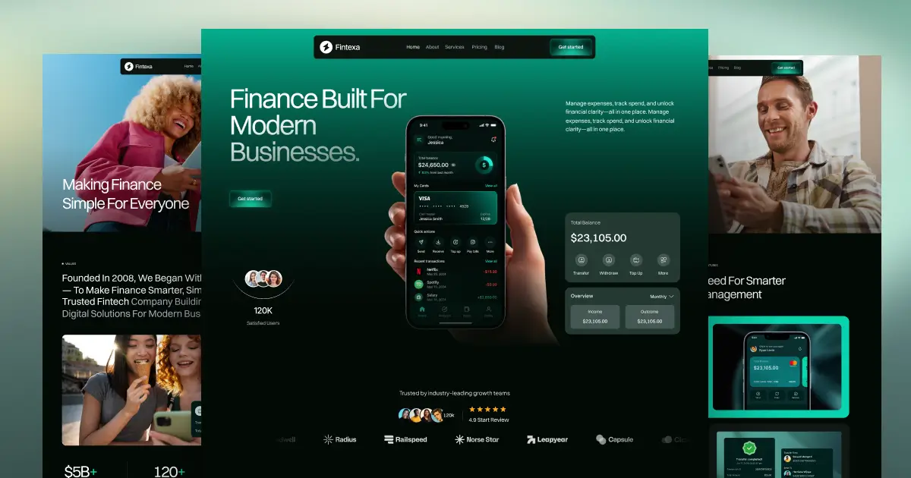

# Fexiva — Fintech Astro Theme with Strapi CMS

Fexiva is a dark, motion-rich landing site theme for fintech, banking and spend-management products. It ships with a Strapi-powered blog and integrations directory, smooth scroll, scroll-reveal and hover interactions, Lottie product animations and fully responsive layouts.

**Live demo:** https://fexiva-astro-theme.vercel.app



## Features

- **Astro 7**, static output: every page is pre-rendered HTML
- **Strapi 5 CMS** for Blog Posts (with Authors) and Integrations, with dynamic `/blog/[slug]` and `/integrations/[slug]` pages
- **Works without a CMS**: bundled sample content is used until you connect Strapi
- 15 page templates: Home, About, Features, Pricing, Contact, Blog, Blog post, Integrations, Integration detail, Style Guide, Instructions, Licenses, Changelog, 404 and 401
- Scroll-reveal, page-load and hover interactions (GSAP), Lenis smooth scrolling, Lottie animations and an animated number counter
- Category tabs, featured posts and related posts on the blog
- SEO ready: per-page titles and descriptions, Open Graph and Twitter tags, canonical URLs, `sitemap-index.xml` and `robots.txt`
- Contact and newsletter forms that post to any form backend

## Quick start

Requires Node.js 22.23.4 or newer.

```sh
npm install
npm run dev
```

Open http://localhost:4321. Without any configuration the site renders the bundled sample content.

| Command           | Action                                   |
| :---------------- | :--------------------------------------- |
| `npm run dev`     | Start the dev server at `localhost:4321` |
| `npm run build`   | Build the production site to `./dist/`   |
| `npm run preview` | Preview the production build locally     |

## Environment variables

Copy `.env.example` to `.env`:

| Variable               | Purpose                                                                                      |
| :--------------------- | :------------------------------------------------------------------------------------------- |
| `STRAPI_URL`           | Base URL of your Strapi instance. Leave empty to use the bundled sample content.             |
| `STRAPI_API_TOKEN`     | Read-only Strapi API token. Used only at build time and never sent to the browser.           |
| `PUBLIC_FORM_ENDPOINT` | URL that receives form submissions (Formspree, Basin, your own API). Empty = demo mode.      |
| `SITE_URL`             | Production URL for canonical links, Open Graph images and the sitemap. On Vercel it defaults to the project domain. |

## Connecting Strapi

The `strapi/` folder is a ready-to-run Strapi 5 project with the content types already defined:

| Content type    | Fields                                                                                                                         |
| :-------------- | :----------------------------------------------------------------------------------------------------------------------------- |
| **Blog Post**   | title, slug, excerpt, mainImage, category (Fintech / Product / Security / Company), featured, publishedDate, readTime, author → Author, body, articleImages, bodyContinued |
| **Author**      | name, photo, role, bio                                                                                                         |
| **Integration** | name, slug, excerpt, logo, category, body, articleImages, bodyContinued                                                        |

1. Start Strapi:
   ```sh
   cd strapi
   cp .env.example .env   # then replace every "tobemodified" value
   npm install
   npm run develop
   ```
2. Create your admin user at http://localhost:1337/admin.
3. Optional: load the demo content. Create an **Admin token** (Settings → Admin Tokens) with Content Manager and Media Library access, fill in the seed variables in `strapi/.env`, then run `npm run seed`. The script uploads the media and creates and publishes every entry through the [Strapi MCP server](https://docs.strapi.io/cms/features/strapi-mcp-server).
4. Create a **read-only API token** (Settings → API Tokens) and set `STRAPI_URL` and `STRAPI_API_TOKEN` in the theme's `.env`.
5. Restart `npm run dev`. The blog and integrations now come from Strapi.

Pages are pre-rendered, so in production rebuild the site after publishing content. A Strapi webhook (Settings → Webhooks) pointing to your host's deploy hook does this automatically.

The Strapi MCP server is enabled in `strapi/config/server.ts`, so AI assistants can manage content at `POST /mcp` with an Admin token, for example:

```sh
claude mcp add strapi-mcp --transport http http://localhost:1337/mcp -H "Authorization: Bearer YOUR_ADMIN_TOKEN"
```

## Project structure

```text
/
├── public/
│   ├── cms/              # Sample content media (used when STRAPI_URL is empty)
│   ├── documents/        # Lottie animation files
│   ├── images/           # Theme images, icons and favicons
│   └── js/               # webflow.js interaction runtime + vendor scripts (jQuery, GSAP, Lenis)
├── src/
│   ├── components/
│   │   ├── blog/         # Blog card, post meta, featured badge
│   │   ├── cms/          # Collection list wrapper, rich text (Blocks) renderer, article body
│   │   ├── global/       # Header, Footer, SEO, scripts, form handler
│   │   ├── integrations/ # Integration card
│   │   └── sections/     # Page sections, grouped by page (shared/ holds CTA, FAQ, Blog section…)
│   ├── config/site.ts    # Site name, SEO defaults, navigation, footer, social links, blog categories
│   ├── data/             # Bundled sample content
│   ├── layouts/          # BaseLayout
│   ├── lib/              # Strapi client, blog list rules, helpers
│   ├── pages/            # Routes
│   └── styles/           # Theme CSS
└── strapi/               # Strapi 5 CMS project (content types, MCP config, seed data and script)
```

## Customisation

- **Branding & navigation:** edit `src/config/site.ts`.
- **Colours, typography, spacing:** CSS custom properties at the top of `src/styles/fexiva.webflow.css`.
- **Logo & favicons:** replace the files in `public/images`.
- **Sections:** each page in `src/pages` is assembled from components in `src/components/sections`.
- The full guide is on the `/instructions` page of the demo.

## Deploying

The site is fully static. On Vercel or Netlify, import the repository and use the defaults (`npm run build`, output `dist`). Add the environment variables above in your host's dashboard.

## Credits

Designed by [Ink Studio](https://inks.studio/). Fonts: Switzer (Fontshare) and Plus Jakarta Sans (Google Fonts). Animation libraries: GSAP, Lenis and Lottie. See the `/licenses` page for details.
